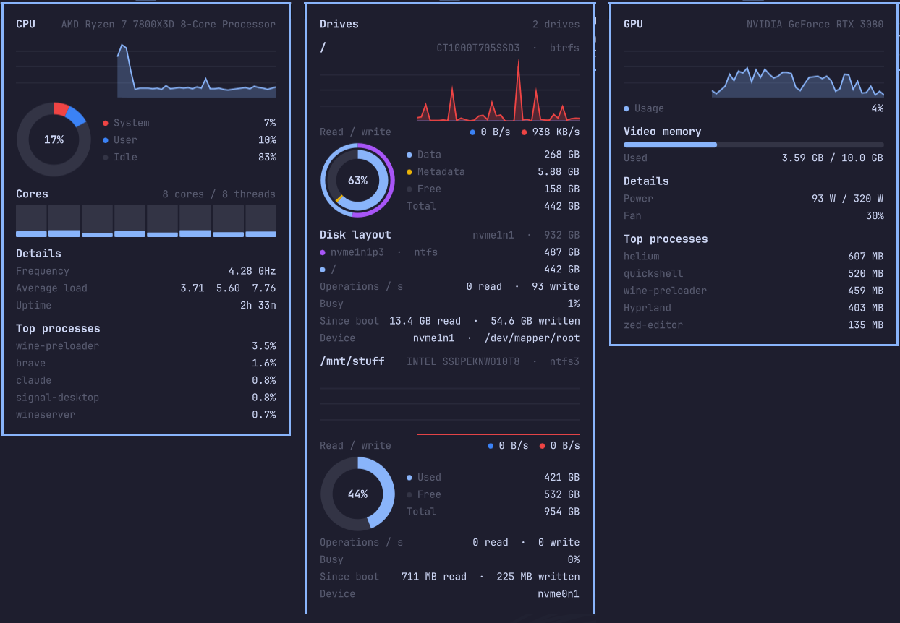

# omarchy-stats

CPU, memory, disk, network, GPU and temperatures in the [Omarchy](https://omarchy.org) bar, in the style of the macOS [Stats](https://github.com/exelban/stats) app.




Each reading is its own item in the bar; click one to open its card:

- **Network:** download and upload speed with a chart, interface, local IP, MAC, DNS and totals; public IP optional.
- **CPU:** model, usage with a chart, system/user split, per-core bars, load, frequency, uptime and current top processes.
- **Memory:** usage with a chart, app/cache/free, swap, pressure and top processes.
- **Disk:** every drive with a read/write chart, a donut of what fills it and how its disk is partitioned, operations, busy time and totals.
- **GPU:** model, usage with a chart, video memory, power, fan and top processes. NVIDIA and AMD.
- **Temperature:** chosen temperatures in the bar (the CPU's by default), a chart, and every sensor in the card.

## Install

```sh
omarchy plugin add https://github.com/lkshrk/omarchy-stats --enable
omarchy bar put lkshrk.stats
```

Update with `omarchy plugin update lkshrk.stats`.

## Configure

```sh
omarchy bar set lkshrk.stats items net,cpu,ram,disk,gpu        # which items show (default: all)
omarchy bar set lkshrk.stats temps cpu,gpu                     # temperatures in the bar
omarchy bar set lkshrk.stats charts net                        # charts only in the network card (default: all)
```

All settings, sensor ids and how to get motherboard and RAM temperatures: [docs/configuration.md](docs/configuration.md).
What it reads and how often: [docs/how-it-works.md](docs/how-it-works.md).

## Requirements

Omarchy 4. Uses `jq`, `ip`, `findmnt`, `lsblk`, `df` and `ps`, which ship with Omarchy; `curl` for the optional public IP; `nvidia-smi` (from the NVIDIA driver) for NVIDIA GPUs. No root needed.

## License

MIT
