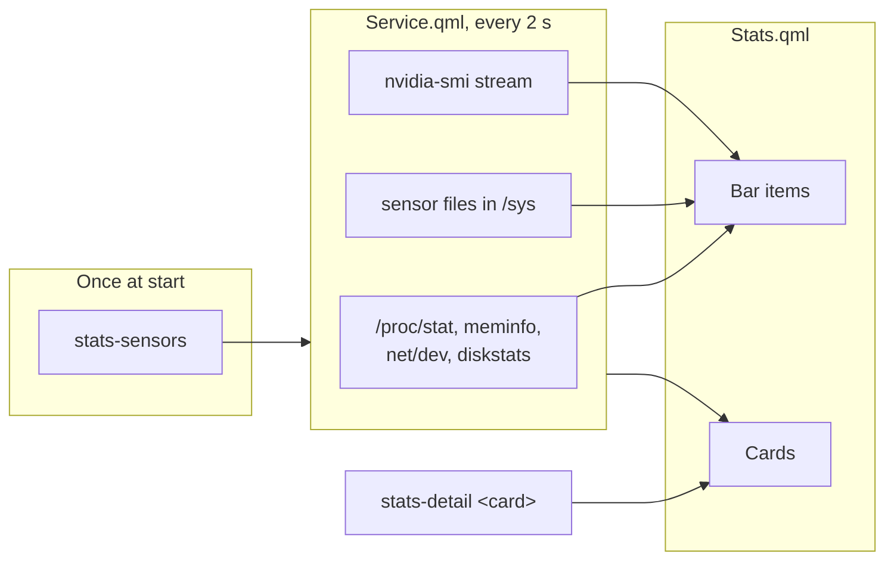

# How it works

A third-party Omarchy shell plugin: a background service collects the readings, the bar widget shows them and opens one card per reading. Everything is read from `/proc` and `/sys`, plus `nvidia-smi` for NVIDIA GPUs. Nothing needs root.

## Files

| File | Role |
| --- | --- |
| `manifest.json` | Declares the plugin `lkshrk.stats`: a `service` and a `bar-widget`. |
| `Service.qml` | The service: samples every 2 seconds and keeps two minutes of history. One instance, shared by the widget on every screen. |
| `Stats.qml` | The bar widget and its cards; reads the settings from `shell.json`. |
| `StatsChart.qml` | The line charts and donuts, drawn on a canvas. |
| `stats-sensors` | Runs once at start: finds the temperature sensors, physical disks, GPU, and CPU model and core count. |
| `stats-detail` | Gathers what one card shows beyond the samples: `stats-detail <cpu\|ram\|net\|disk\|gpu> [mount]`. |

## Data flow

## What is read, and how often

| What | How often |
| --- | --- |
| CPU, per-core, memory, network and disk speed; temperatures | every 2 s, from files in `/proc` and `/sys` (no processes started) |
| Disk usage for the bar | every 30 s (`df`) |
| NVIDIA GPU | one `nvidia-smi` process that streams a line every 2 s, running only while the `gpu` or `temp` item is shown |
| Card details (top processes, load, network details, GPU processes) | every 2 s while that card is open |
| Drive list for the disk card | at start and every 30 s while the `disk` item is shown |
| Public IP | when the network card opens, only with `publicIp` on |

## Loading a card

Each card fetches only its own details, one `stats-detail` run at a time. The last result is kept per card, so a card shows its previous figures at once when it opens again while fresh ones load. The drive list is fetched ahead, so the disk card is complete the first time it opens.

## Notes on the numbers

- **Network speed** adds up every interface except loopback, Docker, virtual bridges and Tailscale.
- **Top processes (CPU)** is the current use as a share of all cores: the change in each process's CPU time since the previous fetch, or over half a second on a first open. Processes are grouped by program, so a browser's helper processes count as the browser.
- **Drives**: a partition mounted several times (btrfs subvolumes) counts once, under its shortest mount. The donut's inner ring splits a btrfs filesystem into data and metadata, others into used and reserved; the outer ring shows how the physical disk is partitioned (partitions under 1% left out).
- **Busy** is the share of time the drive had requests in flight.

## Development

Edits do not reload on their own: run `omarchy restart shell` after changing a file, and read errors with `journalctl --user -t omarchy-shell`. Check the plugin with `omarchy plugin validate <folder>` before pushing; every push to `main` reaches users on their next `omarchy plugin update`.
